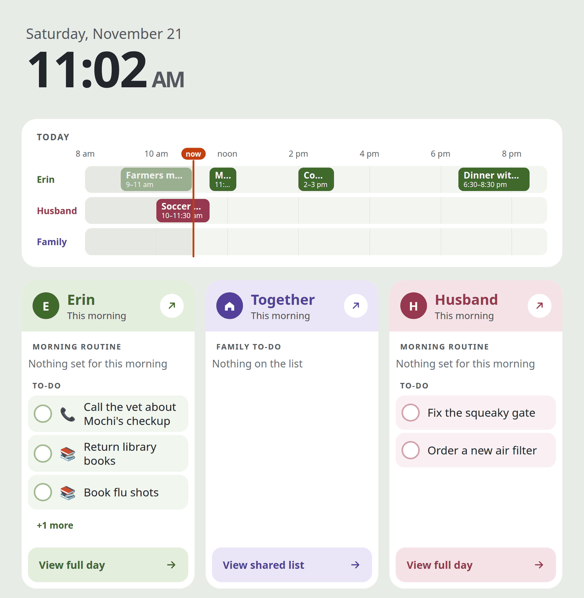
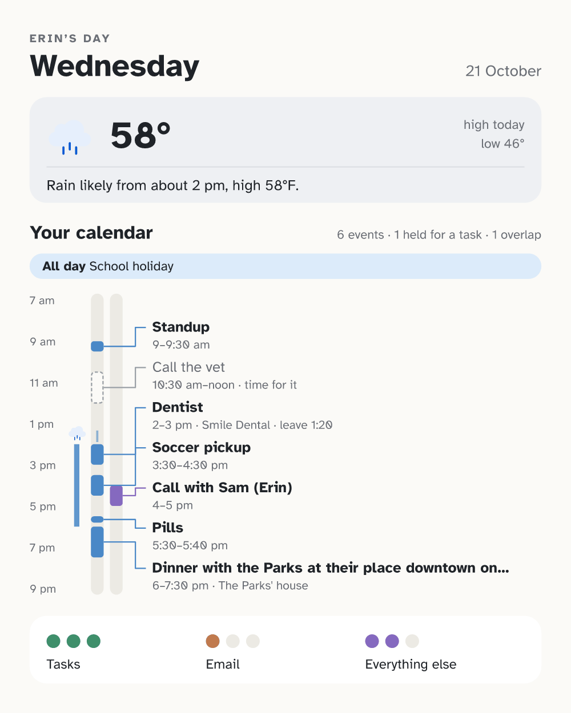
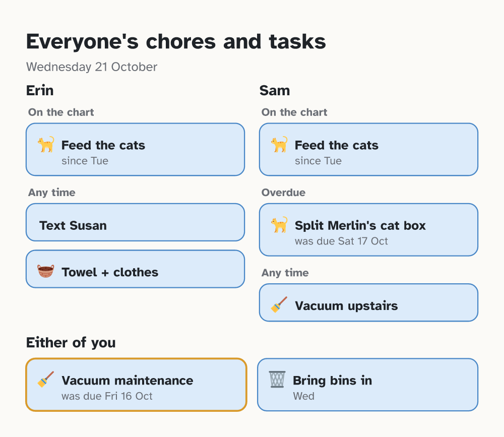
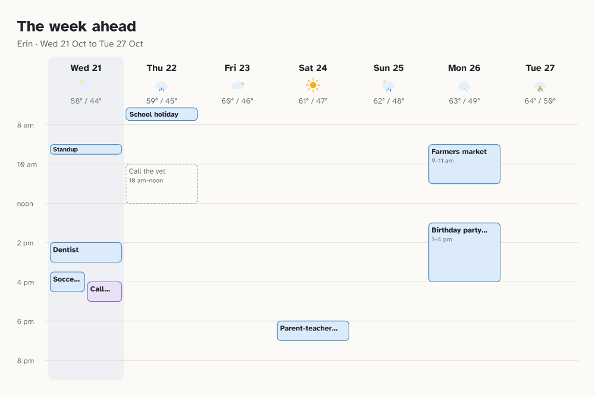
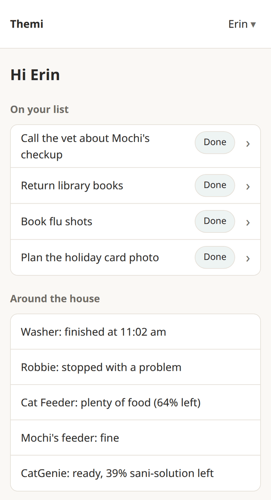
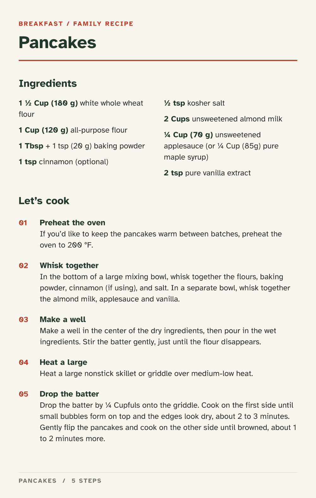

# Themi

**A household assistant that takes the admin off your plate, and knows when to ask.**

Themi is a helper your family runs on its own server. Everyone chats with it in Telegram.
In the background it keeps the calendar, the chores, the email, the groceries and the house
in order, and it times every nudge to when each person actually has room for it. Its
messages are suggestions, never demands.

<picture>
  <source media="(prefers-color-scheme: dark)" srcset="docs/images/wall-dark.png">
  
</picture>

  <a href="docs/INSTALL.md"><b>Install</b></a> ·
  <a href="docs/FEATURES.md"><b>Everything it does</b></a> ·
  <a href="docs/SERVICES.md"><b>Connecting services</b></a> ·
  <a href="docs/DEVELOPMENT.md"><b>Developing</b></a>

## Just talk to it

Plain words, a voice note or a photo. Themi turns them into tasks, reminders, events and
grocery items, and speaks up when the house needs a hand.

<picture>
  
</picture>

- **One message in the morning.** Today's calendar, with everything else waiting behind a
  button. Tap "Just one thing" on a hard day.
- **Timed to your energy.** Themi learns when each person tends to have room, and holds
  the non-urgent until then. Urgent things always come through.
- **Gentle by design.** Every message is checked for pressure before it's sent, and there's
  a daily limit on what Themi brings up unasked.

## Your day, drawn

Themi draws the day as a picture: the weather, your calendar, time it's holding for a task,
and what's waiting. The week ahead, your tasks and the family's chores are a message away.

  <picture>
    <source media="(prefers-color-scheme: dark)" srcset="docs/images/day-card-dark.png">
    
  </picture>
  

<picture>
  <source media="(prefers-color-scheme: dark)" srcset="docs/images/week-dark.png">
  
</picture>

## A wall for the whole family

Put the **wall** page on a frame in the kitchen: the time, today's timeline for each person,
everyone's to-dos, routines and chores side by side, the week ahead, parcels and the shared
lists. Tick things off right there. It goes dim at bedtime and shows tomorrow's plan.

## The house looks after itself

The washer, the dishwasher, the robot vacuum, the pet feeders and the litter box all tell
Themi how they're doing. When one needs a person, it becomes a chore for **whoever has more
room**, with a nudge a little later. If it sorts itself out first, nobody hears a thing.

- *"The washer finished at 11:02 am. Into the dryer now, or later?"*
- *"The vacuum's stuck in the kitchen. Free it and pop it back on the dock?"*
- *"Has the cat been fed?"* Themi checks the feeder.

Email works the same way. Themi reads each person's inbox, raises what's urgent, drafts
replies for a yes, gathers the noise into one message, and notices when an expected bill
doesn't arrive. Nothing is sent, moved or archived without the say-so you've given it.

Every Themi has its own website too, for each person's settings, tasks, lists and recipes.
It works on a phone.

 

## In the kitchen

The family cookbook lives in a Google Doc; Themi reads it, adds to it, and finds new
recipes from a link, a web search or a photo of a page.

Start cooking (from chat, the website or the wall) and a phone or kitchen tablet becomes the
**cook screen**:

- gather and prep, then one step at a time
- this step's amounts, in cups *and* grams
- timers on a rail, and questions by push-to-talk
- the oven preheated when the recipe says so (GE Café through SmartHQ)
- music for the mood, and Themi the chameleon for company

Ingredients go onto the grocery list, which stays in step with OurGroceries and Google
Keep ("Hey Google, add milk"), and a Chrome helper can fill the Safeway cart.

 

## You stay in charge

- **Trust tiers.** Anything that changes something (an event, an archived email, a ticked
  chore) starts as "ask first". Each person decides what Themi may do on its own, and
  Themi always says what it did.
- **Private by default.** It runs on your own machine. Tokens and keys are encrypted, each
  person's calendar is theirs unless they share it, and backups are encrypted too.
- **Your choice of AI.** Claude, Gemini (the free tier is plenty to start), OpenAI,
  OpenRouter, or a local model that never leaves the house. Each person can have their own.
- **Kind when it's hard.** "Today's too much" gets a few things and spreads out the rest.
  Burnout mode holds everything and quietly passes urgent things to a partner.

## What it connects to

Turn on only what your household uses. Not a family? The `work` template makes a Themi for
one person's working day, in Slack.

## Get started

You need a small Linux computer (a Raspberry Pi is plenty), a Telegram bot token from
@BotFather and a free Gemini key. Then:

1. Run `deploy/install.sh` on that computer. It prints the website's address and a claim
   code.
2. Open the address, enter the code, and save the secret key it shows you.
3. On the **Modules** page, paste the bot token and the AI key, and press **Restart**.
4. Invite the family from the **Family** page. Each person sends `/start <code>` to the bot.

The [installation guide](docs/INSTALL.md) has the details, and other ways to run it
(Docker by hand, without Docker, in the cloud).

## Documentation

| Page | What's in it |
| --- | --- |
| [INSTALL.md](docs/INSTALL.md) | Installing Themi, claiming it, inviting the family |
| [FEATURES.md](docs/FEATURES.md) | Everything Themi does, area by area |
| [SERVICES.md](docs/SERVICES.md) | Setting up Google and each device |
| [MORNING_MESSAGE.md](docs/MORNING_MESSAGE.md) | How the morning message works |
| [DEPLOY.md](docs/DEPLOY.md) | A cloud server, HTTPS with Tailscale Funnel, backups, upgrades |
| [RASPBERRY_PI.md](docs/RASPBERRY_PI.md) | Painless deploys on a Raspberry Pi |
| [ENVIRONMENT.md](docs/ENVIRONMENT.md) | Every setting, for `.env` and scripted installs |
| [DEVELOPMENT.md](docs/DEVELOPMENT.md) | Working on the code: tests, the simulator, the rules |
| [BUILD_PROMPTS.md](docs/BUILD_PROMPTS.md) | The build order and progress |
