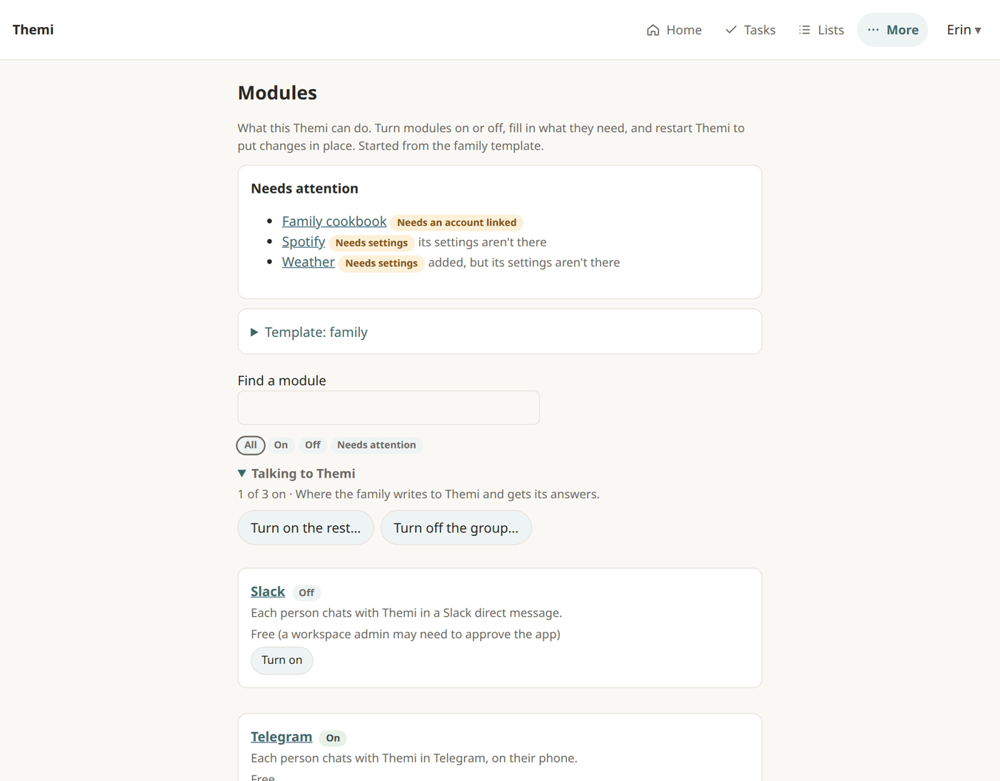

# Installing Themi

Themi runs on one small computer that your household owns or rents: a Raspberry Pi in a
cupboard, an old laptop, or a few-dollars-a-month cloud server. Everyone else just uses
Telegram and a website. This guide gets a new Themi running and the family talking to it.

## What you need

- **A computer to run it on**, with Linux (Ubuntu or Debian) and an internet connection.
  A Raspberry Pi 4 or 5 is plenty. [DEPLOY.md](DEPLOY.md) compares hosts and prices.
- **A Telegram bot.** Message [@BotFather](https://t.me/BotFather) in Telegram, send
  `/newbot`, and keep the token it gives you. It's free.
- **An AI model.** A free [Gemini API key](https://aistudio.google.com/apikey) is enough to
  start. Claude, OpenAI, OpenRouter and local models (Ollama, LM Studio...) work too, and
  each person can use their own.
- **About 30 minutes**, plus 15 more if you'll link Gmail and Google Calendar.

Everything else (Google, the washer, the wall frame, the pet feeders...) is optional and
can be added later from the website.

## 1. Install it

On the computer that will run Themi:

```sh
bash install.sh     # deploy/install.sh from this repository
```

It installs Docker, writes a short `.env`, offers to set up
[Tailscale Funnel](https://tailscale.com/kb/1223/funnel) so the website has a stable HTTPS
address (and walks you through making a Tailscale account), starts Themi, and prints the
website's address and a **claim code**.

## 2. Claim it

Open the address and enter the claim code. You name the household (or yourself, for a
work Themi) and become its first admin.

The next page shows Themi's **secret key**. Save it in a password manager, away from the
server. It encrypts every stored token, key and backup: without it, none of them can be
read again.

## 3. Turn on what you want



The **Modules** page is where Themi is set up. Modules are grouped by what they're for
(talking to Themi, AI, voice and pictures, tasks, your day, services), and a whole group
can be turned on at once. Each module's page has its settings, who may use it, a **Test**
button, and its setup guide beside the boxes.

Start with these two:

1. **Telegram**: paste the bot token from @BotFather.
2. **An AI provider**: paste the Gemini key (or another provider's).

Press **Restart** on the same page to put changes in place. Add more modules whenever you
like; [SERVICES.md](SERVICES.md) has the longer setup notes for Google and each device.

## 4. Invite the family

On the **Family** page, invite each person. They get a code, send `/start <code>` to the
bot in Telegram, and they're in. Sending `/site` gives them a sign-in link for the website,
where their own settings live (quiet hours, the morning message, how much detail their
calendar shares, and so on).

That's it: Themi starts learning when each person has room for things, and says good
morning the next day.

## Other ways to run it

### With Docker, by hand

```sh
docker compose up --build -d      # start (a new Themi prints its claim code in the log)
docker compose logs -f themi      # watch for the claim code
```

The database lives in the `themi-data` volume. `docker compose down` stops Themi gracefully:
the message or job in progress finishes first. `tools/smoke_container.sh` builds the image and
checks it starts, reports healthy, and stops cleanly.

For scripted installs, `docker compose run --rm themi init` and
`docker compose run --rm themi invite <name>` still work.

### Without Docker

With Python 3.12 or newer:

```sh
pip install -e .        # or: make venv && make install
themi run
```

A new Themi makes its own secret key (next to its database) and prints a claim code. It
starts the scheduler and the website (`/health` on port 8080). Then carry on from
[step 2](#2-claim-it), at <http://localhost:8080>.

Some device libraries are optional extras: `pip install -e '.[thinq]'`, `'.[roborock]'`,
`'.[smarthq]'`, `'.[ourgroceries]'` and `'.[keep]'`. The Docker image includes all but
Keep. A module whose library is missing says "Not in this install" on the Modules page.

### Settings from the environment

Every setting can come from `.env` or the environment instead of the website.
[ENVIRONMENT.md](ENVIRONMENT.md) lists them. A value set there wins, and the Modules page
shows it as "set on the server" with a button to move it into Themi.

### Just trying it out

To see a new Themi as an installer meets it, without touching anything real, clone the
repository and run `make fresh`. It opens at <http://localhost:8080> with its own data in
`data/fresh/`. To try the chat with a pretend family and pretend devices, see
[DEVELOPMENT.md](DEVELOPMENT.md#trying-themi-on-this-computer).

## Keeping it running

- **Backups**: `themi backup` and `themi restore`, nightly and encrypted, to Cloudflare R2 or
  Backblaze B2. [DEPLOY.md](DEPLOY.md#7-turn-on-nightly-backups) sets them up.
- **Upgrades**: an admin can update and restart Themi from the website's Development page,
  or by hand as [DEPLOY.md](DEPLOY.md#9-upgrades) describes.
- **On a Raspberry Pi**: [RASPBERRY_PI.md](RASPBERRY_PI.md) is the plan for painless
  deploys from published images.
- **Something went wrong?** Anyone can send `/bug what happened` in the chat. An admin reads
  the reports with `themi feedback`.
